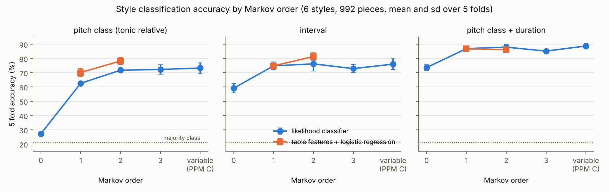
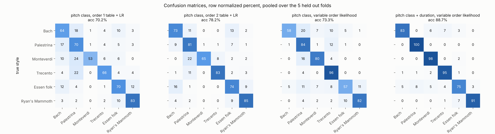
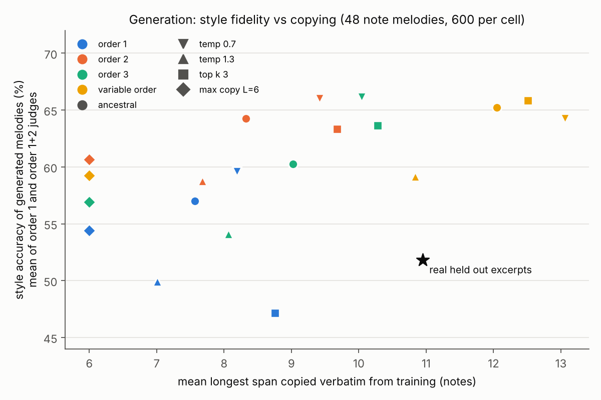

# Markov order, style classification and melody generation

Branch `experiments/music-markov`. Everything below was produced by the scripts in this folder on Nov 2, 2026 (music21 10.5.2, scikit learn, Python 3.13).

## Plain language summary

1. Sanity check: my rewrite of the first order fingerprint gets 70.2% (sd 2.7) on the rebuilt corpus, against the 70.9% reported before. Close enough to treat the corpus as equivalent.
2. For classification, more memory helps, but only up to order 2. Order 2 tables lift pitch class accuracy from 70.2% to 78.2%, and intervals from 74.8% to 81.4%.
3. Order 3 and variable order (PPM C) add little on top of order 2: 72 to 73% for the pitch class likelihood classifiers, within one sd of order 2.
4. Variable order is the most robust likelihood model: it is never worse than the best fixed order by more than about one point, and it is the top method with durations (88.7%).
5. What you count matters more than how far back you look: adding a duration bucket to each pitch moves every method to 85 to 89%, a bigger jump than any change of order.
6. The persistent confusions are musically sensible: Bach with Palestrina (both vocal and stepwise), Essen folk with Ryan's fiddle tunes, and Bach with Essen (simple diatonic tunes).
7. For generation, order 2 and variable order give the most style typical melodies (about 64 to 66% judged correct, versus 57% for order 1 with plain sampling).
8. Higher order buys style by copying: variable order with plain sampling copies spans of 12 notes on average and 99% of its 4 grams already occur in training. Order 1 copies only about 8 notes.
9. The max copy sampler (no verbatim span over 6 notes) keeps most of the gain: order 2 with max copy L=6 is the best balance (61% judged correct, 6 note copies, 69% distinct 4 grams), so it is the sampler used for the audio clips.
10. Caution: the automatic judges rate generated melodies above real held out excerpts (52%), so they measure typicality, not musical conviction. A listening test or LLM judge is still needed (not run here, see below).

## Data: rebuilt seqs_v2.json

Built by `build_data.py` from the music21 corpora. Top voice of multi voice scores, ties merged, chords reduced to their top note, rests kept as pitch -1 and merged, grace notes dropped, pieces with fewer than 16 notes dropped. Tonic from `score.analyze('key')` on the full score. Random sample with seed 0, cap 210 per style.

| style | music21 source | pieces | median notes per piece | major key pieces |
|---|---|---|---|---|
| Bach | `bach/*.mxl, *.xml` (chorales, soprano) | 210 | 49 | 105 |
| Palestrina | `palestrina/*.krn` (top voice) | 210 | 97 | 110 |
| Monteverdi | `monteverdi/*.mxl` madrigals (all 49 available, top voice) | 49 | 175 | 8 |
| Trecento | `trecento/*` (all 103, top voice) | 103 | 273 | 38 |
| Essen folk | `essenFolksong/*.abc` (8,514 tunes, 210 sampled) | 210 | 44 | 164 |
| Ryan's Mammoth | `ryansMammoth/*.abc` | 210 | 118 | 158 |
| total | | 992 | | |

Majority class rate is 21.2% (6 classes). Monteverdi and Trecento are capped by what music21 ships, so macro F1 is reported next to accuracy.

## Sanity check

`fingerprint_check.py`: 12 tonic relative scale degrees, rests skipped, row normalized 12x12 table (144 numbers), `LogisticRegression(max_iter=5000)` (multinomial), `StratifiedKFold(5, shuffle=True, random_state=0)`.

| | accuracy |
|---|---|
| reported (first-order-fingerprint.py) | 70.9% |
| this rebuild, plain LR | **70.2% ± 2.7** (folds 66.3, 71.9, 71.7, 67.7, 73.2) |
| this rebuild, standardized features + LR | 68.2% ± 0.9 |

The original script could not be downloaded (zhiqian.ai is blocked by this session's network policy), so this is a reimplementation from the description. The 0.7 point gap is within one fold sd and is most likely due to the different random sample of pieces.

## A. Classification by order

`classify.py`. The same 5 folds for every method (`common.folds`). Table features: row normalized transition tables of order 1 (A x A) and order 2 (A x A x A, sparse), logistic regression. Likelihood classifiers: one model per style trained on the training folds, held out piece assigned to the style with the highest mean log probability per note. Fixed order k uses Lidstone smoothing (alpha 0.1) on the order k context and backs off to the longest seen shorter context only when the order k context never occurred in training. Variable order is interpolated PPM with escape method C over orders 0 to 5 (the IDyOM style blend). Representations: tonic relative pitch class (12 symbols), interval in semitones clipped to ±12 (25 symbols), pitch class times a 5 level duration bucket (<0.5, <1, <2, <4, ≥4 quarters, 60 symbols).

| representation | method | order | accuracy % (mean ± sd) | macro F1 % (mean ± sd) |
|---|---|---|---|---|
| pitch class (tonic relative) | table features + LR | 1 | 70.2 ± 2.7 | 68.9 ± 4.6 |
| pitch class (tonic relative) | table features + LR | 2 | 78.2 ± 2.4 | 78.5 ± 4.1 |
| pitch class (tonic relative) | table features + LR | 1+2 | 78.4 ± 1.3 | 78.8 ± 3.8 |
| pitch class (tonic relative) | likelihood classifier | 0 | 27.2 ± 1.4 | 22.7 ± 1.9 |
| pitch class (tonic relative) | likelihood classifier | 1 | 62.6 ± 0.8 | 60.7 ± 1.1 |
| pitch class (tonic relative) | likelihood classifier | 2 | 71.8 ± 1.6 | 69.7 ± 2.2 |
| pitch class (tonic relative) | likelihood classifier | 3 | 72.3 ± 3.3 | 70.3 ± 3.5 |
| pitch class (tonic relative) | likelihood classifier | variable (PPM C, max 5) | 73.3 ± 3.7 | 71.8 ± 3.7 |
| interval | table features + LR | 1 | 74.8 ± 2.2 | 76.1 ± 2.1 |
| interval | table features + LR | 2 | 81.4 ± 2.7 | 82.0 ± 2.5 |
| interval | table features + LR | 1+2 | 82.1 ± 2.9 | 83.4 ± 2.5 |
| interval | likelihood classifier | 0 | 59.2 ± 3.2 | 57.2 ± 3.2 |
| interval | likelihood classifier | 1 | 74.8 ± 2.7 | 73.0 ± 2.7 |
| interval | likelihood classifier | 2 | 76.2 ± 5.0 | 74.5 ± 5.2 |
| interval | likelihood classifier | 3 | 72.9 ± 2.8 | 70.1 ± 2.5 |
| interval | likelihood classifier | variable (PPM C, max 5) | 76.0 ± 3.7 | 74.8 ± 3.4 |
| pitch class + duration | table features + LR | 1 | 86.8 ± 0.6 | 86.4 ± 1.8 |
| pitch class + duration | table features + LR | 2 | 86.2 ± 1.5 | 83.2 ± 2.1 |
| pitch class + duration | table features + LR | 1+2 | 87.3 ± 1.7 | 83.8 ± 5.1 |
| pitch class + duration | likelihood classifier | 0 | 73.6 ± 1.9 | 70.0 ± 3.1 |
| pitch class + duration | likelihood classifier | 1 | 86.9 ± 0.6 | 85.4 ± 1.2 |
| pitch class + duration | likelihood classifier | 2 | 87.9 ± 1.8 | 86.4 ± 1.9 |
| pitch class + duration | likelihood classifier | 3 | 85.2 ± 0.9 | 83.6 ± 1.5 |
| pitch class + duration | likelihood classifier | variable (PPM C, max 5) | 88.7 ± 1.8 | 87.1 ± 2.1 |

Smoothing sensitivity, pitch class likelihood classifiers (accuracy %):

| Lidstone alpha | order 1 | order 2 | order 3 |
|---|---|---|---|
| 0.01 | 62.7 | 71.7 | 70.2 |
| 0.1 | 62.6 | 71.8 | 72.3 |
| 1.0 | 62.7 | 73.2 | 74.0 |

### Which styles get confused

| method | top confused pairs (pieces misassigned in either direction, pooled over folds) |
|---|---|
| pc, LR order 1 | Bach and Palestrina (73), Essen folk and Ryan's Mammoth (46), Bach and Essen folk (46) |
| pc, LR order 2 | Bach and Essen folk (61), Bach and Palestrina (42), Essen folk and Ryan's Mammoth (37) |
| pc, LL variable (PPM C, max 5) | Essen folk and Ryan's Mammoth (44), Bach and Palestrina (43), Palestrina and Trecento (30) |
| pcdur, LL variable (PPM C, max 5) | Essen folk and Ryan's Mammoth (22), Bach and Essen folk (17), Palestrina and Essen folk (16) |
| int, LR order 2 | Bach and Essen folk (46), Bach and Palestrina (34), Essen folk and Ryan's Mammoth (29) |

Full confusion matrices for every method are in `results/classification.json` (rows true, columns predicted, style order Bach, Palestrina, Monteverdi, Trecento, Essen, Ryan's).

## B. Generation by order

`generate.py`. Pitch class tokens. For each of the 5 folds and each style, models are trained on that fold's training pieces only and each order x sampler cell draws 20 melodies of 48 notes per style per fold (600 per cell). Samplers: ancestral (temperature 1), temperature 0.7 and 1.3, top k 3, and max copy (ancestral, but any next note that would make the current verbatim match with a training melody longer than L = 6 notes is masked, using a suffix automaton over the training melodies).

Metrics, all computed within a fold against that fold's training data, then averaged over styles, mean ± sd over folds:

* style accuracy: share of generated melodies that a classifier trained on the real training pieces assigns to the intended style. Order 1 judge is the 144 number logistic regression asked for. Because that judge only sees first order statistics, I added an order 1+2 judge (order 1 table plus order 2 table).
* novelty: longest span copied verbatim from the training melodies of that style, and share of 4 grams that occur in training.
* diversity: distinct 4 grams over all samples in a cell, and mean pairwise normalized edit distance.
* The "real held out" row applies the same metrics to the first 48 notes of real held out pieces.

| order | sampler | style acc, order 1 judge % | style acc, order 1+2 judge % | longest copied span (notes) | 4 grams seen in training % | distinct 4 grams % | pairwise edit distance |
|---|---|---|---|---|---|---|---|
| real held out | n/a | 55.4 ± 2.0 | 48.2 ± 3.0 | 10.9 | 91.0 | 57.3 | 0.75 |
| 1 | ancestral | 64.7 ± 2.0 | 49.3 ± 3.0 | 7.6 | 80.2 | 68.3 | 0.75 |
| 1 | temp 0.7 | 70.0 ± 4.6 | 49.2 ± 2.5 | 8.2 | 89.0 | 52.4 | 0.72 |
| 1 | temp 1.3 | 56.0 ± 2.7 | 43.8 ± 3.6 | 7.0 | 71.5 | 78.3 | 0.77 |
| 1 | top k 3 | 59.3 ± 3.1 | 35.0 ± 2.2 | 8.8 | 95.9 | 19.4 | 0.67 |
| 1 | max copy L=6 | 63.5 ± 3.6 | 45.3 ± 3.3 | 6.0 | 78.7 | 70.7 | 0.75 |
| 2 | ancestral | 62.0 ± 1.9 | 66.5 ± 1.6 | 8.3 | 90.2 | 62.8 | 0.75 |
| 2 | temp 0.7 | 65.8 ± 2.2 | 66.2 ± 1.4 | 9.4 | 96.5 | 45.1 | 0.71 |
| 2 | temp 1.3 | 56.8 ± 1.9 | 60.7 ± 3.3 | 7.7 | 80.5 | 74.7 | 0.77 |
| 2 | top k 3 | 66.3 ± 3.3 | 60.3 ± 2.4 | 9.7 | 99.0 | 25.6 | 0.70 |
| 2 | max copy L=6 | 59.2 ± 2.2 | 62.2 ± 2.1 | 6.0 | 87.3 | 69.4 | 0.76 |
| 3 | ancestral | 59.8 ± 3.9 | 60.7 ± 3.7 | 9.0 | 92.5 | 63.5 | 0.76 |
| 3 | temp 0.7 | 68.7 ± 2.0 | 63.7 ± 4.7 | 10.0 | 98.9 | 46.2 | 0.72 |
| 3 | temp 1.3 | 49.5 ± 4.4 | 58.7 ± 2.5 | 8.1 | 80.4 | 77.1 | 0.78 |
| 3 | top k 3 | 63.7 ± 3.1 | 63.7 ± 2.2 | 10.3 | 99.9 | 32.5 | 0.71 |
| 3 | max copy L=6 | 53.0 ± 7.5 | 60.8 ± 6.5 | 6.0 | 88.1 | 72.9 | 0.77 |
| variable (PPM C) | ancestral | 63.0 ± 5.1 | 67.5 ± 2.2 | 12.1 | 99.4 | 57.7 | 0.75 |
| variable (PPM C) | temp 0.7 | 62.5 ± 2.8 | 66.0 ± 2.1 | 13.1 | 99.9 | 48.7 | 0.72 |
| variable (PPM C) | temp 1.3 | 55.8 ± 3.3 | 62.5 ± 1.5 | 10.8 | 98.1 | 63.8 | 0.76 |
| variable (PPM C) | top k 3 | 66.2 ± 6.0 | 65.5 ± 2.3 | 12.5 | 99.9 | 47.2 | 0.72 |
| variable (PPM C) | max copy L=6 | 56.7 ± 4.3 | 61.8 ± 3.4 | 6.0 | 96.2 | 69.4 | 0.77 |

Style accuracy by style (order 1 judge, %), plain sampling and the chosen sampler:

| order | sampler | Bach | Palestrina | Monteverdi | Trecento | Essen folk | Ryan's Mammoth |
|---|---|---|---|---|---|---|---|
| real held out | n/a | 61 | 58 | 36 | 41 | 65 | 71 |
| 1 | ancestral | 54 | 66 | 42 | 63 | 82 | 81 |
| 1 | max copy L=6 | 47 | 63 | 41 | 64 | 74 | 92 |
| 2 | ancestral | 56 | 63 | 37 | 64 | 67 | 85 |
| 2 | max copy L=6 | 45 | 66 | 33 | 61 | 64 | 86 |
| 3 | ancestral | 41 | 64 | 29 | 66 | 73 | 86 |
| 3 | max copy L=6 | 33 | 60 | 25 | 57 | 63 | 80 |
| var | ancestral | 59 | 65 | 34 | 55 | 76 | 89 |
| var | max copy L=6 | 42 | 49 | 32 | 59 | 76 | 82 |

Sampler choice for audio was fixed before looking at clips: among samplers whose mean longest copy stays at or below the real held out reference (10.9 notes) for every order, take the one with the highest style accuracy averaged over orders and both judges. Only temperature 1.3 (55.5%) and max copy L=6 (57.8%) qualify, so max copy L=6 is used.

Reading the table: order 1 melodies are diverse and copy little, but the order 1+2 judge recognizes them only about as often as real excerpts. Orders 2, 3 and variable order raise style accuracy under the order 1+2 judge to 60 to 67%. Lower temperature and top k raise accuracy further only by repeating training material (top k 3 has 19 to 47% distinct 4 grams, and 99 to 100% of its 4 grams appear in training). Variable order with ordinary sampling reaches the longest copies (12 to 13 notes), which is above even real held out pieces. Max copy L=6 removes that, at a cost of about 4 to 6 points of style accuracy for orders 2 and up.

## C. Audio for slides

`audio.py`, files in `audio/`. For Bach chorales (72 bpm) and Essen folk songs (100 bpm): one real held out melody from fold 0 (first test piece in a major key that fills 15 s), and one generated melody each at order 1, 2, 3 and variable order, sampler max copy L=6, trained on fold 0 training pieces of that style. One sample per order with a fixed seed, no cherry picking. Generated scale degrees are placed in the real melody's key at the octave nearest the previous note, inside the real melody's range, and play with the real melody's rhythm, so only the pitch sequence differs between clips of a style.

| clip | content | notes | seconds |
|---|---|---|---|
| `bach_real` | BWV 329 soprano, held out | 21 | 20.0 |
| `bach_order1`, `bach_order2`, `bach_order3`, `bach_ordervar` | generated, max copy L=6 | 21 | 20.0 |
| `essen_real` | Essen `zuccal0.abc` tune 634, held out | 46 | 19.8 |
| `essen_order1`, `essen_order2`, `essen_order3`, `essen_ordervar` | generated, max copy L=6 | 46 | 19.8 |

Each clip has `.mid`, `.wav` (FluidR3 GM acoustic grand piano via fluidsynth, 22.05 kHz mono) and `.json` with `[[midi, dur_seconds], ...]` (rests folded into the previous note). `clips.json` in this folder bundles all ten note lists in the same shape as `src/clips.json`. `audio/clips_manifest.json` records sources, sampler and the longest copied span of each generated clip (6 notes for all).

## What I could not run, and caveats

* **The original fingerprint script** could not be fetched (zhiqian.ai is outside this session's allowed network). The sanity check is a reimplementation from the description. Allowing zhiqian.ai in the environment network settings would let a later session diff the two.
* **LLM judge A/B (optional metric 4) was not run.** The session has no Anthropic API key, so no model calls could be made. The excerpt pairs needed for it are easy to produce with `audio.py` style rhythm transfer.
* **Duplicate tunes.** The Bach corpus contains the same chorale tunes in several harmonizations. 75 of 210 Bach pieces share a verbatim span of 16 or more notes with their training fold, and 9 are near duplicates (`leakage_check.py`, `results/leakage_check.json`). Other styles have 0 to 4 near duplicates. This favors high order likelihood models on Bach somewhat, and it explains why real held out excerpts copy 10.9 notes on average.
* **Duration encodings differ by corpus.** Palestrina and Trecento editions use long note values, so the pitch plus duration results (85 to 89%) partly reflect notation conventions, not only musical style.
* **Piece length differs by style** (median 44 notes for Essen, 273 for Trecento), so per piece tables are estimated from very different amounts of evidence.
* Generation was done in the pitch class representation only, so generated melodies have no rhythm of their own. The audio clips borrow the real melody's rhythm.

## Files

| path | what |
|---|---|
| `build_data.py` | rebuilds `data/seqs_v2.json` and `data/counts.json` (about 7 minutes on 4 cores) |
| `common.py` | data loading, folds, representations, Markov and PPM C models, suffix automaton for copy detection |
| `fingerprint_check.py` | sanity check |
| `classify.py` | part A, writes `results/classification.json` |
| `generate.py` | part B, writes `results/generation_rows.json` and `results/generation_summary.json` |
| `audio.py` | part C, writes `audio/` and `clips.json` |
| `leakage_check.py` | duplicate tune check |
| `figures.py` | figures and `results/tables.md` |
| `make_results.py` | fills this file from `results_template.md` and `results/tables.md` |

Run order: `python3 build_data.py && python3 fingerprint_check.py && python3 classify.py && python3 generate.py && python3 audio.py && python3 leakage_check.py && python3 figures.py && python3 make_results.py`. Needs music21, scikit learn, scipy, matplotlib, pretty_midi, and fluidsynth with a GM soundfont (falls back to sine synthesis if missing).
